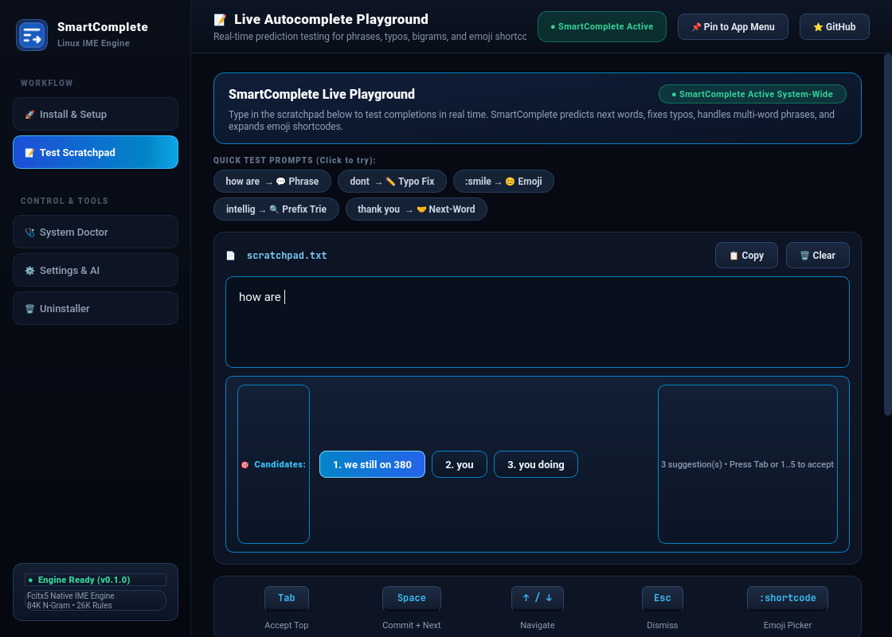

# SmartComplete 🚀

<div align="center">

-2ea44f?logo=linux&logoColor=white)


**System-wide intelligent text prediction, autocomplete, and typing copilot for Linux.**  
Context-aware next-word prediction, phrase completion, typo correction, and emoji shortcodes across all Wayland and X11 applications.

[Quick Start](#-quick-start--installation) •
[Features](#-key-features) •
[GUI Control Center](#-graphical-installer--control-center) •
[How It Works](#-how-it-works) •
[Usage & Shortcuts](#-usage-guide--shortcuts) •
[Credits & Backbone](#-credits--acknowledgements)

</div>

---

## 📸 Interface Preview

<div align="center">
  
</div>

<p align="center">
  <em>SmartComplete Graphical Setup Wizard with automated distro probe, dependency resolution, build pipeline, and one-click deployment.</em>
</p>

---

## ✨ What is SmartComplete?

**SmartComplete** brings smartphone-style and IDE-grade intelligent text completion to your entire Linux desktop. Whether you are typing in **Google Chrome**, **VS Code**, **Discord**, **LibreOffice**, **Slack**, or your favorite terminal emulator, SmartComplete operates in the background as a native **Fcitx5 Input Method Engine (IME)**.

As you type, an elegant, unobtrusive candidate ribbon appears right at your cursor, suggesting relevant words, predicting your next thought, auto-correcting typos, and expanding emoji shortcodes — all with **sub-5-millisecond latency** and **100% offline local execution**.

---

## 🎯 Key Features

- 🏎️ **Ultra-Fast & Offline**: Written in high-performance C++17 with trie prefix lookups and bigram probability ranking. Operates 100% offline with zero telemetry.
- 🌐 **True System-Wide Integration**: Works seamlessly on both **Wayland** (Hyprland, Sway, GNOME, KDE Plasma) and **X11**.
- 🧠 **6 Blended Prediction Strategies**:
  - **Trie Prefix Search**: Instant word completion over an 84,000-word dictionary.
  - **Bigram Next-Word Prediction**: Anticipates what you will type next using 48,000+ statistical word pairs.
  - **Multi-Word Phrases**: Expands common idioms and sentences (e.g. `how are` → `you doing`).
  - **Contextual Grammar Rules**: 26,000+ linguistic rules to select natural verbs, prepositions, and modal forms.
  - **Adaptive Typo Correction**: Levenshtein distance calculations correct swapped or missing keys on the fly.
  - **Emoji Shortcodes**: 303+ instant shortcodes (e.g. `:smile` → 😊, `:fire` → 🔥, `:heart` → ❤️).
- 📈 **Personal Vocabulary Learning**: Actively adapts to your writing style. Words you accept receive a **10× frequency multiplier** in the scoring engine.
- 🤖 **Optional AI Reranker**: Optionally connects to any OpenAI-compatible API (local LLM or cloud) for nuanced candidate re-ranking when context is ambiguous.
- 🎨 **Modern Graphical Installer & Control Center**: Includes an automated Setup Wizard, Live Playground, 7-Point System Health Doctor, Settings Manager, and Safe Uninstaller.

---

## 🚀 Quick Start & Installation

### Option 1: Modern Graphical Installer (Recommended)

SmartComplete includes a desktop installer and control center.

1. **Clone the repository:**
   ```bash
   git clone https://github.com/arik-sadman313/smartcomplete.git
   cd smartcomplete
   ```

2. **Launch the GUI Installer:**
   - **Double-click** `SmartComplete-Install.desktop` in your file manager, or
   - Run from terminal:
     ```bash
     ./gui-installer.sh
     ```
   *(Running `./install.sh` also automatically detects graphical sessions and opens the GUI).*

3. Click **🚀 Install SmartComplete Now**. The installer will:
   - Probe your distribution (`pacman`, `apt`, `dnf`, or `zypper`).
   - Automatically install missing build dependencies (`cmake`, `fcitx5`, `json-c`, `g++`).
   - Compile the C++17 prediction core and run 13 automated unit tests.
   - Install libraries to `/usr/lib/fcitx5/` and data assets to `/usr/share/linuxcomplete/`.
   - Configure your input method environment variables and autostart profile.
   - Restart Fcitx5 ready for instant typing!

---

### Option 2: Headless / Terminal Install (CLI)

For servers, minimal window managers, or headless environments without Python PyQt6:

```bash
./install.sh --cli
```

---

## 🖥️ Graphical Installer & Control Center

The built-in Control Center provides five specialized management tools:

| Tab | Purpose |
|---|---|
| **🚀 Install & Setup** | Automated pre-flight environment probe, build pipeline streaming, and 1-click deployment. |
| **📝 Live Playground** | Interactive typing scratchpad to test autocomplete, typo correction, and emoji shortcodes in real time without affecting other apps. |
| **🩺 System Doctor** | 7-point health check verifying daemon processes, addon `.so` files, data dictionaries, profiles, and autostart with 1-click quick-fixes. |
| **⚙️ Settings & AI** | Fine-tune candidate count (1–10), minimum prefix length, user learning multiplier, terminal blocklist, and optional OpenAI-compatible AI reranking. |
| **🗑️ Safe Uninstaller** | Cleanly removes all binaries, restores your original default keyboard layout, and allows optional backup or purge of learned user vocabularies. |

### Visual Walkthrough

<div align="center">
  
  
</div>

<div align="center">
  
  
</div>

---

## ⌨️ Usage Guide & Shortcuts

Once installed, SmartComplete is active anywhere you type on Linux.

### Keybindings & Controls

| Key | Action |
|---|---|
| `Tab` | Accept the top / highlighted candidate |
| `1` .. `5` | Instantly accept candidate by number |
| `Space` | Commit top candidate and append a space |
| `↑` / `↓` | Navigate through candidates in the ribbon |
| `Esc` | Dismiss candidate ribbon without committing |
| `:shortcode` | Trigger emoji shortcode picker (e.g. `:rocket` → 🚀) |

### Testing in the Playground
Launch the standalone scratchpad anytime to test suggestions:
```bash
./gui-installer.sh --tab scratchpad
```

### Checking System Health
If candidates do not show up in a specific app, launch the System Doctor:
```bash
./gui-installer.sh --tab doctor
```

---

## 🏗️ Architecture & How It Works

SmartComplete uses a modular layered architecture:

```
┌────────────────────────────────────────────────────────┐
│                   Linux Applications                   │
│   (Chrome, Firefox, VS Code, Discord, Terminal, etc.)  │
└──────────────────────────┬─────────────────────────────┘
                           │ Wayland / X11 Key Events
┌──────────────────────────▼─────────────────────────────┐
│                 Fcitx5 Input Framework                 │
│         (/usr/lib/fcitx5/linuxcomplete.so)             │
├────────────────────────────────────────────────────────┤
│                 SmartComplete Engine                   │
│  ┌──────────────────────────────────────────────────┐  │
│  │               Prediction Dispatcher              │  │
│  └──────┬────────────┬────────────┬───────────┬─────┘  │
│         │            │            │           │        │
│    ┌────▼───┐   ┌────▼───┐   ┌────▼───┐  ┌────▼────┐   │
│    │  Trie  │   │ Bigram │   │ Grammar│  │  Emoji  │   │
│    │ Prefix │   │ N-Gram │   │ Rules  │  │Shortcode│   │
│    └────┬───┘   └────┬───┘   └────┬───┘  └────┬────┘   │
│         │            │            │           │        │
│  ┌──────▼────────────▼────────────▼───────────▼─────┐  │
│  │          Multi-Strategy Candidate Scorer         │  │
│  │   Score = Freq * Weight + UserHistory(10x)       │  │
│  └──────────────────────┬───────────────────────────┘  │
│                         │                              │
│  ┌──────────────────────▼───────────────────────────┐  │
│  │      Optional AI Reranker (OpenAI / Local)       │  │
│  └──────────────────────┬───────────────────────────┘  │
└─────────────────────────┼──────────────────────────────┘
                          │
         ┌────────────────▼────────────────┐
         │  Fcitx5 Candidate Ribbon Popup  │
         │  [1. hello]  [2. help]  [3. he] │
         └─────────────────────────────────┘
```

---

## 📦 Supported Linux Distributions

SmartComplete has been tested and packaged for:

- **Arch Linux / Omarchy / Manjaro / EndeavourOS** (`pacman`)
- **Ubuntu / Debian / Linux Mint / Pop!_OS** (`apt`)
- **Fedora / RHEL** (`dnf`)
- **openSUSE Tumbleweed / Leap** (`zypper`)

### System Requirements
- Linux kernel 5.x or newer
- Wayland compositor (Hyprland, Sway, GNOME, KDE) or X11
- Fcitx5 core framework (`fcitx5`)
- CMake 3.20+ and C++17 compatible compiler (`g++` or `clang++`)
- Python 3.9+ and PyQt6 (for GUI installer & control center)

---

## 🗑️ Safe Uninstallation

To completely remove SmartComplete and restore your previous keyboard input settings:

- **Via GUI:** Run `./gui-installer.sh --tab uninstall` or `./uninstall.sh`.
- **Via CLI:** Run `./uninstall.sh --cli`.

The uninstaller removes `/usr/lib/fcitx5/linuxcomplete.so`, assets in `/usr/share/linuxcomplete`, restores `~/.config/fcitx5/profile`, and gives you the option to keep or purge your learned vocabulary cache.

---

## 👥 Credits & Acknowledgements

SmartComplete stands on the shoulders of outstanding open-source projects and developers:

- **Ekrem ([@ekremx25](https://github.com/ekremx25))**:
  - Original author and creator of the **SmartComplete** C++ prediction backbone, 84K trie dictionary, 48K bigram datasets, contextual grammar pattern engine, and initial Fcitx5 addon integration ([ekremx25/smartcomplete](https://github.com/ekremx25/smartcomplete)).
- **Weng Xuetian ([@CSSlayer](https://github.com/CSSlayer)) & The Fcitx5 Community**:
  - Creators and maintainers of [Fcitx5](https://github.com/fcitx/fcitx5), the next-generation, modular, and extensible Linux input method framework.
- **Arik Sadman ([@arik-sadman313](https://github.com/arik-sadman313))**:
  - Designer and developer of the modern **PyQt6 Graphical Installer & Control Center**, automated system doctor, interactive real-time typing playground, 4-tier dark theme UI architecture, automated distro dependency probe, and packaging pipeline.

---

## 📄 License

This project is open-source software licensed under the **[MIT License](LICENSE)**.
Feel free to use, modify, distribute, and contribute back!
